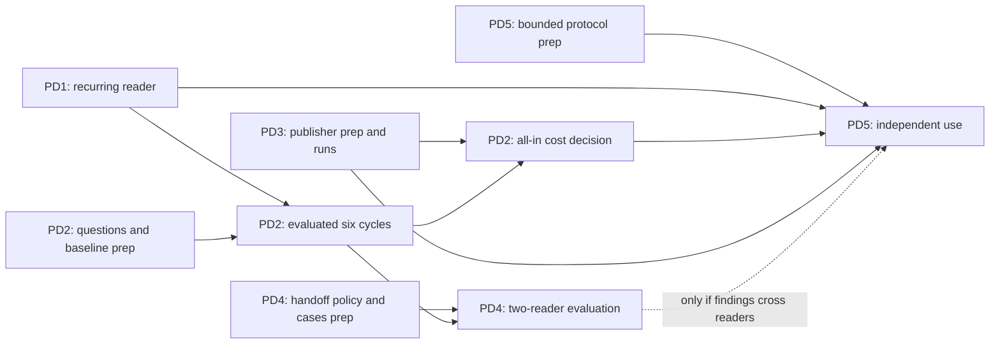

# Roadmap

**Now:** v1.0 — stable wire format, shipped reference implementations and packages, dogfood on [pagedigest.org](https://pagedigest.org). Gates: [RELEASE_CHECKLIST.md](./RELEASE_CHECKLIST.md).

## Active outcome priorities — November 4, 2026

The next outcome is a returning reader completing useful work, retaining its
source dependencies and revisiting the right material after a change. The stable
protocol and generators exist; experimental `sync`/`remember` and publisher
helpers supply the starting implementation. Python 0.2.0 does not contain these
commands. The packets below are planned outcome work, not new shipped capability.

Choose ready work from the graph, with one coordinator integrating disjoint
worker lanes. Preparation can overlap; acceptance still needs the specified
inputs. [Execution guide](docs/agent-execution.md) owns dispatch and joins;
[validation guide](docs/validation.md) owns check selection.

| Packet | Ready work and file ownership | Acceptance and join |
| --- | --- | --- |
| **PD1 — Reproducible recurring reader** | Start now. Consumer lane owns CLI/recurring/cache files and their tests in `implementations/python-consumer/`, excluding publisher-helper tests, plus `docs/recurring-consumer.md`. Extend the three-visit demo to a maintained source-install path, an inspectable saved answer, restart/recovery instructions and a versioned local wheel candidate. | A fresh environment answers a small-site question, saves its declared sources, exits and returns to identify what needs rereading. Exercise old-cache migration and missing-body recovery. Coordinator freezes a minimum CLI/storage interface for PD2; PD1 packaging/docs can continue alongside evaluation. Package release remains a separate delivery action. |
| **PD2 — Useful work over six cycles** | Start question, oracle and baseline preparation now in a new dated evaluation directory and dedicated harness files. Freeze three recurring questions, equal discovery/cache opportunities and a freshness/audit policy before observing outcomes. Run against PD1's minimum path when ready. | Initial read, unchanged revisit, relevant change, irrelevant change, cache loss and failed-deployment recovery produce evaluated answers and omissions. Relevant evidence is reread and unrelated usable work retained. Include all attempts, failures, requests/bytes, local integrity reads, parsing and unfinished work. Combine PD3 publisher effort before accepting an all-in cost conclusion. Fix the largest observed gap before expanding. Supplied finding text alone is insufficient. |
| **PD3 — Maintainable publisher path** | Start independently. Publisher lane owns `tools/publisher_workflow.py`, `implementations/python-consumer/tests/test_publisher_workflow.py` and `docs/publisher-workflow.md`; book Astro/generator changes with coordinator before touching shared files. Exercise two existing builds, including Astro, through setup and two updates. | Build inventories derive automatically; state restoration and served-byte verification work without a second page catalog. Lost state never silently restarts history. Record operator time, interventions, unexpected revision churn and recovery cost for PD2/PD5. Consumer readiness is not a prerequisite for publisher work. |
| **PD4 — Finding handed to another reader** | Start handoff schema/policy/counterexample preparation independently in dedicated draft files, coordinated with DotRepo D4. After the minimum consumer interface is frozen, integrate file export/import into two isolated stores under the coordinator's consumer-file ownership handoff. | A useful **evaluated PD2 finding** is required to accept the real handoff. Carry claim, scope, sources/hashes, assumptions and original observation time; recipient validates under its own policy. Exercise relevant change, missing source and conflicting interpretation. Compare with sharing the same cached source alone. Unchanged sources do not prove a conclusion correct. |
| **PD5 — Independent recurring use** | Prepare the finite pilot protocol and operating-guide outline now. Actual independent use waits for PD1 readiness, PD2 useful-work evaluation and PD3 publisher readiness; PD4 is required only when findings cross readers. | Freeze useful outputs, freshness, run count and spending ceiling. Compare total publisher + intermediary + consumer work against competent HTTP/sitemap/fingerprint alternatives, including setup, audits, fallback and maintenance. Report favorable and unfavorable workload regions separately. Outreach, paid activity and package release need task-specific authorization; this plan grants none. |

**First dispatch:** PD1 plus PD2 question/baseline preparation and PD3 publisher
preparation, as slots permit. For a four-slot team spanning both projects, reserve
one coordinator, prioritize DotRepo D1 + PageDigest PD1, and rotate the third
worker through ready evaluation/publisher preparation. Refill slots after a small
accepted handoff; do not allocate a standing agent to every role or make workers
repeat the full integration gate. The parent coordinator owns cross-project
contract joins; standalone PageDigest work uses the same local graph.

**Go/no-go rule:** completion, freshness and correct invalidation come first;
economic benefit includes publisher work. Preserve the [38.6% byte overhead](docs/benchmarks/digest-exchange-p1-20261029/README.md)
and [six-cycle 14-request/1,199-byte result](docs/benchmarks/recurring-workflow-20261104/README.md).
These local controls are not independently useful work or adoption. If a matched
workload still loses, simplify, narrow the intended use or prefer ordinary HTTP
caching. Never drop audits, missing results or failed attempts to claim a win.

**Deferred:** extra SSG plugins, broad crawler distribution, manifest sharding,
new hash/discovery mechanisms, observation-counter polish and shared-memory
services. Reopen only for a named workflow's demonstrated limit. Protocol
stability and deployment/recovery controls remain obligations.

## Delivery history and retained evidence

The [dated roadmap snapshot](docs/archive/roadmap-through-20261104.md#delivery-history-and-retained-evidence)
preserves source-delivery notes, the completed protocol phases, release evidence
and reserved extensions. Historical status is dated; use the graph above for work.
Original studies, negative results and captured artifacts remain at their paths.

Earlier section links resolve here. See the archived [consumer safety milestone](docs/archive/roadmap-through-20261104.md#consumer-safety-milestone-released-september-16-2026),
[Phase 1](docs/archive/roadmap-through-20261104.md#phase-1--public-rc),
[Phase 2](docs/archive/roadmap-through-20261104.md#phase-2--distribution),
[Phase 3](docs/archive/roadmap-through-20261104.md#phase-3--publisher-path),
[Phase 4](docs/archive/roadmap-through-20261104.md#phase-4--consumer-path),
[Phase 5](docs/archive/roadmap-through-20261104.md#phase-5--standards-registration),
[Phase 6](docs/archive/roadmap-through-20261104.md#phase-6--v10) and
[reserved extensions](docs/archive/roadmap-through-20261104.md#post-10-reserved).

## Contribute

Open an issue referencing a ready packet, its owned files and acceptance evidence.
Start with a bounded deliverable from the graph; independent operation follows a
usable, evaluated candidate. Keep implementation/test counts separate from utility.
