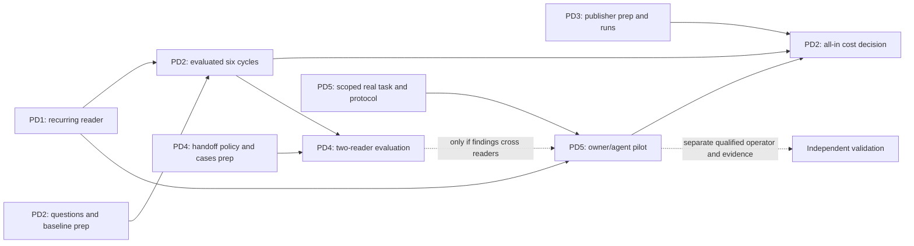

# Roadmap

**Now:** v1.0 — stable wire format, shipped reference implementations and packages, dogfood on [pagedigest.org](https://pagedigest.org). Gates: [RELEASE_CHECKLIST.md](./RELEASE_CHECKLIST.md).

## Active outcome priorities — November 5, 2026

The next outcome is a returning reader completing useful work, retaining its
source dependencies and revisiting the right material after a change. The stable
protocol and generators exist; experimental `sync`/`remember` and publisher
helpers supply the starting implementation. Python 0.2.0 does not contain these
commands. The graph distinguishes locally accepted implementation from remaining
outcome work; the local candidate is not a new published package.

Choose ready work from the graph, with one coordinator integrating disjoint
worker lanes. Preparation can overlap; acceptance still needs the specified
inputs. [Execution guide](docs/agent-execution.md) owns dispatch and joins;
[validation guide](docs/validation.md) owns check selection.

**November 5 user scope change:** Use `maxwellsantoro.com` for a bounded
owner/agent-operated recurring pilot. Follow the parent's
[pilot plan](/Users/maxwell/projects/lazy-collective/docs/pilots/maxwellsantoro-20261105.md)
for the real task, permitted sources and measured attempts. Missing human effort
or complete all-in cost data does not block pilot execution or demonstrated
repairs; collect available measurements prospectively and leave gaps explicit.
Independent third-party validation remains a separate claim, not a prerequisite
to this first-party use. Scheduled operating history is an ongoing observation,
not a seven-day wait before product work. Earlier independent-pilot criteria and
sealed comparisons retain their historical meaning; this dated change authorizes
a new execution scope without relabeling old evidence.

**November 4 local batch checkpoint:** PD1 source install and the local
`0.3.0.dev1` wheel candidate are accepted at
`e38084da3727c31cf921874102412a5eb08bf3e9`, with read-only saved-answer/source
inspection and restart, legacy-cache and missing-body recovery controls. See
[the recurring guide](docs/recurring-consumer.md) and
[local acceptance artifacts](/Users/maxwell/Documents/Codex/2026-11-04/task/next-team-batch/acceptance/).
The [PD2 preparation](docs/evaluations/next-team-batch-20261104/README.md) freezes
three questions and six cycles, including failure/recovery, with a same-cache
baseline and separate oracle. The [corrected PD2 comparison](docs/evaluations/pd2-results-20261105.md)
is independently scored: 18/18 useful task/cycles and 108/108 points per arm,
with higher measured treatment request/body cost and no combined-cost benefit.
Actual PD3 builds passed engineering controls; human upkeep and independent
operation remain open. The local wheel is not a package release. Source integration
passed hosted CI in [PR12](https://github.com/lazy-collective/pagedigest/pull/12),
merged at `51a3e1b9`, and passed main checks and existing strict website deployment.

| Packet | Ready work and file ownership | Acceptance and join |
| --- | --- | --- |
| **PD1 — Reproducible recurring reader** | Locally accepted source-install path, saved-answer/source inspection, restart/recovery guide and `0.3.0.dev1` wheel candidate. Preserve them; assign consumer files only for a demonstrated repair. Source is merged in PR12 with hosted checks and existing site deployment passed; package publication remains separate and excluded. | A fresh environment answers a small-site question, saves its declared sources, exits and returns to identify what needs rereading. Exercise old-cache migration and missing-body recovery. Use the accepted minimum CLI/storage interface for PD2; any repair needs focused review before dependent execution continues. Package release remains a separate delivery action. |
| **PD2 — Useful work over six cycles** | Completed independently scored [corrected comparison](docs/evaluations/pd2-results-20261105.md). Preserve invalid run1, failed-deployment phase, recovery and all costs; no new primary run required. Prefer the measured competent HTTP baseline for this small workload; no efficiency claim or coverage expansion is justified | Initial read, unchanged revisit, relevant change, irrelevant change, cache loss and failed-deployment recovery produce evaluated answers and omissions. Relevant evidence is reread and unrelated usable work retained. Include all attempts, failures, requests/bytes, local integrity reads, parsing and unfinished work. Combine PD3 publisher effort before accepting an all-in cost conclusion. Fix the largest observed gap before expanding. Supplied finding text alone is insufficient. |
| **PD3 — Maintainable publisher path** | Preserve the accepted [Astro/umbrella publisher engineering](/Users/maxwell/Documents/Codex/2026-11-04/task/continuation/acceptance/adapter-publisher-review/publisher-receipt.json). Apply the existing publisher path to the authorized personal-site pilot and record setup/update/recovery attempts alongside PD5; do not replay the earlier build trial. A maintainer or agent may operate this pilot. | Build inventories derive automatically; state restoration and served-byte verification work without a second page catalog. Lost state never silently restarts history. Record available elapsed/counter/intervention evidence from the first attempt; human attention and unavailable costs stay unknown. Complete human/all-in measurements constrain economic claims, not pilot readiness or local improvements. |
| **PD4 — Finding handed to another reader** | Adapter repair review and [actual useful PD03 transfer/source-only comparison](docs/evaluations/pd4-results-20261105.md) are independently accepted. Combined20-stage and separate dev2 wheel checks passed. No further implementation or primary comparison is ready for this bounded finding; source/site delivery receipts are tracked by the parent | A useful **evaluated PD2 finding** is required to accept the real handoff. Carry claim, scope, sources/hashes, assumptions and original observation time; recipient validates under its own policy. Exercise relevant change, missing source and conflicting interpretation. Compare with sharing the same cached source alone. Unchanged sources do not prove a conclusion correct. |
| **PD5 — Recurring pilot and separate independent validation** | Continue the authorized owner/agent pilot on `maxwellsantoro.com` from the latest retained review state on the next real task, using the accepted consumer entrypoint and reusable [operating guide](/Users/maxwell/Documents/Codex/2026-11-04/task/continuation/acceptance/pilot-preparation/operating-guide.md), with the new task/source scope frozen before execution. Collect PD3 measurements concurrently. An independent operator, complete cost record and seven scheduled days are not prerequisites. PD4 is required only when findings cross readers. | Complete the declared bounded task and retain actual initial/revisit outputs, source dates, failures and available publisher/intermediary/consumer costs against a competent baseline. Label owner/agent operation accurately; independent adoption and all-in savings require their own evidence. Keep future real work occasions and operating-history observations distinct from local replay. Outreach, paid activity and package release remain separately authorized actions. |

**Initial pilot checkpoint:** The [first owner/agent maintenance session](/Users/maxwell/projects/lazy-collective/docs/pilots/maxwellsantoro-20261105.md#evidence)
is independently accepted; its two website-description edits were integrated
locally at that session. Both modes identified the two changed pages and retained
the historical trace. That initial source and result remain historical evidence.

**Second real review checkpoint:** The [November 5 revisit](/Users/maxwell/Documents/Codex/2026-11-05/task/next-owner-batch/acceptance/pilot/report.md)
reviewed the later personal-site snapshot `ab4a68b0` plus its two recorded MDX
edits against the same three URLs, using the merged recovery source `52025dd0`.
Both readers found two changed project bodies and the unchanged trace, then
saved three reviewed successor findings each; all original objects and dates
remain intact. Under the declared 100% body-audit policy, ordinary HTTP used
3 requests / 55,237 response-body bytes; PageDigest used 4 / 66,179. The entire
10,942-byte difference was its manifest, followed by the same three full bodies.
Prefer ordinary HTTP for this measured full-audit task. This second local
owner/agent work occasion establishes no quality or all-in cost advantage or
independent adoption. It made no canonical website changes or deployment. Reuse
the latest retained state on the next real task; keep the original receipts.

**Recovery repair checkpoint:** The user authorized reducing the measured
failure/recovery overhead. The [new engineering replay](docs/evaluations/recovery-cost-20261105.md)
preserves the original failed-deployment case, external audits and manual fallback.
Strong-ETag conditional validation reduces its body transfers from 130,657 to
78,656 bytes (39.8%) with the same 12 requests, limited to that original
failure/recovery pair. The repair is merged in
[PR16](https://github.com/lazy-collective/pagedigest/pull/16); it does not remove
the second review's required full-audit transfers. Full-audit and missing/corrupt-body controls
remain intact. The original PD2 score and initial owner-pilot results are unchanged;
the linked delivery record distinguishes review, checked source and deployment.

**Current dispatch:** PD1/PD2 and the bounded PD4 adapter/two-reader trial are
accepted; preserve their exact artifacts, failed attempts and independent
receipts. The new local dev2 wheel has a separate identity from the original PD2
dev1 wheel. Track checked source/site delivery separately in the parent's
canonical map; do not restart accepted implementation or evaluations. Continue the
authorized personal-site pilot from its latest retained review state on the
next real maintenance task, selecting current checked source from the parent's
canonical map. The bounded recovery repair is already merged; do not reimplement
or repeat its accepted replay. Capture available costs while
working; incomplete human/all-in measurements and scheduled history cannot freeze
this lane. The absence of an independent operator limits independent-validation
claims, not first-party execution. Preserve the prior PD2/PD4 evidence and use a
new pilot identity. Reserve a coordinator and refill workers with ready authorized
work. Package publication remains outside this continuation's scope.

Before selecting fresh work after a restart, reconcile canonical main, open PRs,
linked worktrees and accepted but unmerged receipts. Verify actual heads and dirty
state, then continue the earliest unmet join; an old dispatch instruction does
not establish that accepted implementation is missing.

**Go/no-go rule:** completion, freshness and correct invalidation come first;
economic benefit includes publisher work. Preserve the [38.6% byte overhead](docs/benchmarks/digest-exchange-p1-20261029/README.md)
and [six-cycle 14-request/1,199-byte result](docs/benchmarks/recurring-workflow-20261104/README.md).
These local controls are not independently useful work or adoption. If a matched
workload still loses, simplify, narrow the intended use or prefer ordinary HTTP
caching. Never drop audits, missing results or failed attempts to claim a win.

**Deferred:** extra SSG plugins, broad crawler distribution, manifest sharding,
new hash/discovery mechanisms, observation-counter polish and shared-memory
services. Reopen only for a named workflow's demonstrated limit. Protocol
stability and deployment/recovery controls remain obligations.

## Delivery history and retained evidence

The [dated roadmap snapshot](docs/archive/roadmap-through-20261104.md#delivery-history-and-retained-evidence)
preserves source-delivery notes, the completed protocol phases, release evidence
and reserved extensions. Historical status is dated; use the graph above for work.
Original studies, negative results and captured artifacts remain at their paths.

Earlier section links resolve here. See the archived [consumer safety milestone](docs/archive/roadmap-through-20261104.md#consumer-safety-milestone-released-september-16-2026),
[Phase 1](docs/archive/roadmap-through-20261104.md#phase-1--public-rc),
[Phase 2](docs/archive/roadmap-through-20261104.md#phase-2--distribution),
[Phase 3](docs/archive/roadmap-through-20261104.md#phase-3--publisher-path),
[Phase 4](docs/archive/roadmap-through-20261104.md#phase-4--consumer-path),
[Phase 5](docs/archive/roadmap-through-20261104.md#phase-5--standards-registration),
[Phase 6](docs/archive/roadmap-through-20261104.md#phase-6--v10) and
[reserved extensions](docs/archive/roadmap-through-20261104.md#post-10-reserved).

## Contribute

Open an issue referencing a ready packet, its owned files and acceptance evidence.
Start with a bounded deliverable from the graph; owner/agent operation can proceed
with the accepted candidate and declared source scope. Keep independent validation,
implementation/test counts and measured utility separate.
